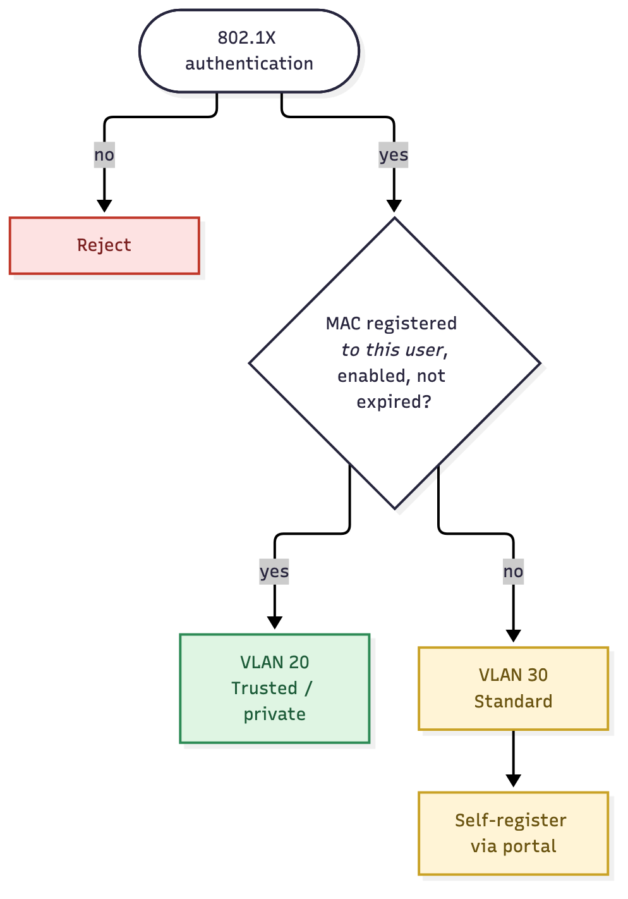



This is the implementation outline behind the NAC workflow: how FreeRADIUS makes the VLAN decision, the database schema it reads from, the config that wires it together, and what the registration flow and MAC randomization mean for it in practice.

## How it works in practice

You don't run MAB and 802.1X as two separate authentications on the same SSID. With WPA2/WPA3-Enterprise, the AP already sends the client MAC in `Calling-Station-Id` on every 802.1X request. So FreeRADIUS:

1. Authenticates the user with 802.1X (PEAP-MSCHAPv2 against AD, or EAP-TLS).
2. In post-auth, looks up whether that MAC is registered.
3. Returns the trusted VLAN if it is, or the standard VLAN if it isn't.



Source: [`outline-flow.mmd`](outline-flow.mmd)

## Bind each MAC to a user, not just a list

If the check is only "is this MAC on the list", any employee with valid credentials can copy a colleague's registered MAC and get the trusted VLAN. Requiring **MAC + authenticated username** to match means a spoofer also needs that colleague's password or certificate. It also gives you per-user device limits and clean offboarding.

## Database schema

```sql
CREATE TABLE registered_devices (
  id            SERIAL PRIMARY KEY,
  mac           CHAR(17)     NOT NULL UNIQUE,   -- normalized AA-BB-CC-DD-EE-FF
  username      VARCHAR(128) NOT NULL,          -- lowercased, no domain/realm
  role          VARCHAR(32)  NOT NULL DEFAULT 'trusted',
  enabled       BOOLEAN      NOT NULL DEFAULT TRUE,
  registered_at TIMESTAMP    NOT NULL DEFAULT NOW(),
  expires_at    TIMESTAMP    NULL,
  last_seen     TIMESTAMP    NULL
);
CREATE INDEX ON registered_devices (username);
```

## FreeRADIUS 3.x config

**`sites-enabled/default`: normalize the MAC in the outer request**

```
authorize {
    rewrite_calling_station_id   # from policy.d/canonicalization → AA-BB-CC-DD-EE-FF
    filter_username
    preprocess
    eap {
        ok = return
    }
    ...
}
```

**`sites-enabled/inner-tunnel`: make the decision here, because this is where the real username is**

The outer identity is often `anonymous@domain`, so the lookup has to run inside the tunnel.

```
post-auth {
    # Strip DOMAIN\ or @realm first (ntdomain / suffix in authorize) so Stripped-User-Name is set
    update control {
        &Tmp-String-0 := "%{sql:SELECT role FROM registered_devices WHERE mac = '%{outer.request:Calling-Station-Id}' AND username = '%{tolower:%{%{Stripped-User-Name}:-%{User-Name}}}' AND enabled AND (expires_at IS NULL OR expires_at > NOW()) LIMIT 1}"
    }

    switch &control:Tmp-String-0 {
        case "trusted" {
            update reply { &Tunnel-Private-Group-Id := "20" }
        }
        case {
            # Unregistered, expired, wrong user, or SQL down → standard VLAN (fail safe)
            update reply { &Tunnel-Private-Group-Id := "30" }
        }
    }

    update reply {
        &Tunnel-Type        := VLAN
        &Tunnel-Medium-Type := IEEE-802
    }

    # Copy the VLAN attributes to the outer Access-Accept
    update {
        &outer.session-state: += &reply:
    }
    ...
}
```

**`sites-enabled/default` post-auth**

The stock 3.0.x config already has this block. Check it hasn't been removed:

```
post-auth {
    update {
        &reply: += &session-state:
    }
    ...
}
```

Some notes on this config:
- `%{sql:...}` escapes its input, and the MAC is normalized first, so injection risk is low. Still, don't loosen `safe_characters`.
- If the database is unreachable, the lookup returns empty and the user lands on VLAN 30. People can still work, and nobody gets trusted access by accident.
- Test it with `eapol_test` (ships with wpa_supplicant), setting `-M <mac>` to simulate registered and unregistered devices.

## Wireless controller side

- **Turn on RADIUS VLAN override on the SSID:** "Allow AAA Override" on Cisco, "RADIUS override" on Meraki, "RADIUS assigned VLAN" on UniFi. Aruba can use VLAN attributes, or you can return `Aruba-User-Role` instead. If this setting is off, the attributes are ignored and everyone lands on the SSID's default VLAN.
- Both VLANs must be trunked to the APs (or tunneled to the controller).
- **Enable CoA** (RADIUS dynamic authorization) so a device moves to VLAN 20 right after registering, without having to reconnect.

## Registration flow

Don't make users type their MAC address.

1. The user connects and lands on VLAN 30.
2. They open the registration portal, which is reachable from VLAN 30, and sign in with SSO.
3. The portal takes their IP, finds the MAC via DHCP leases or RADIUS accounting, and saves `(mac, username, expires_at)`. Enforce a per-user device cap here.
4. The portal sends a CoA or Disconnect for that MAC, the device re-authenticates, and it gets VLAN 20.

## MAC randomization

Per-SSID private MACs (the default on iOS, Android and Windows) stay the same each time the device joins that SSID, so registration still works. The problem is modes that rotate the MAC: iOS "Rotating", Android "non-persistent", and some Windows daily-change settings. Those devices will drop back to VLAN 30. Tell users to set the private address to **Fixed/Off for this SSID**, and show that instruction on the portal when a device that was registered shows up with a new MAC.



