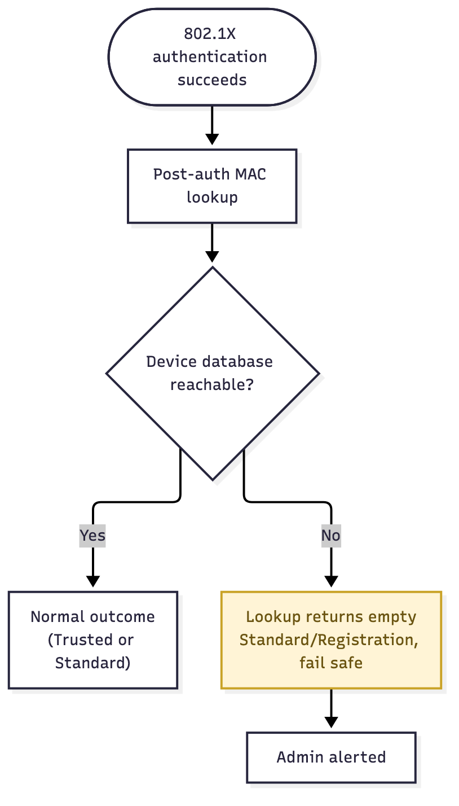

# User Story: DB-Down Fail-Safe

## Story

As an **admin**, when the device database is unreachable, I want every device to fail safe to Standard or Registration access rather than being rejected outright, so an infrastructure outage doesn't lock out the whole organization.

## Flow

1. FreeRADIUS authenticates the user over 802.1X, then runs the MAC lookup in post-auth.
2. The device database is unreachable — down, a network partition, connection pool exhausted.
3. The lookup returns empty instead of a hard error.
4. FreeRADIUS treats that exactly like "not registered": the device falls back to Standard VLAN, or Registration VLAN if [Mandatory Registration](mandatory-registration) is in effect.
5. Once the database recovers, devices resume getting their correct outcome on their next re-auth — no manual recovery step needed.

Source: [`db-down-failsafe.mmd`](db-down-failsafe.mmd)

## Acceptance criteria

- [ ] A database outage degrades devices to the unregistered outcome; it does not cause Access-Reject.
- [ ] No device is granted trusted access as a side effect of the database being unreachable — fail safe, never fail open to trusted.
- [ ] Once the database recovers, normal outcomes resume on a device's next re-auth with no manual step.
- [ ] The failure is visible to admins (logged or alerted), even though it's invisible to users.

## Notes

- This is already the intended behavior described in [Outline's config notes](../OUTLINE) — this story exists so it gets tested and monitored, not just assumed from how the query behaves.
