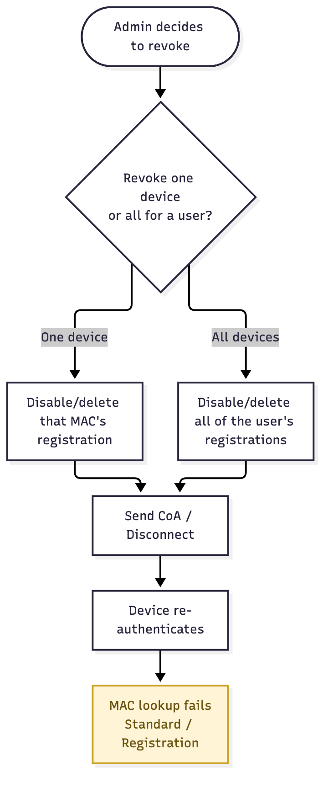

# User Story: Device Offboarding (Revocation)

## Story

As an **admin**, I want to revoke a device, or every device belonging to a user, so that a lost laptop or a departed employee loses access immediately rather than whenever its registration happens to expire.

## Flow

1. Something happens that means a device shouldn't be trusted anymore: it's lost or stolen, or the user it belongs to has left.
2. The admin opens the dashboard and finds the device by MAC, or finds all devices belonging to the user.
3. The admin disables or deletes the registration(s).
4. The admin sends a CoA/Disconnect for the affected MAC(s), forcing an immediate re-auth instead of waiting for the device to reconnect on its own.
5. The device re-authenticates. The MAC lookup no longer matches, so it falls back to the deployment's normal unregistered outcome — Standard VLAN, or the Registration VLAN if [Mandatory Registration](mandatory-registration) is in effect.

Source: [`device-offboarding.mmd`](device-offboarding.mmd)

## Acceptance criteria

- [ ] An admin can disable or delete a single device's registration by MAC.
- [ ] An admin can revoke every device belonging to a user in one action.
- [ ] A CoA/Disconnect is sent so revocation takes effect without waiting for the device's own reconnect.
- [ ] A revoked device falls back to the deployment's normal unregistered outcome — it isn't rejected outright or special-cased.

## Notes

- Works the same whether the device was self-registered ([MAB Registration Workflow](mab-registration-workflow)) or placed by IT ([Secured VLAN Access](secured-vlan-access)).
- If the user's IdP account itself is disabled, 802.1X fails before this is ever reached. This story is for revoking a device while the user's account still works.
