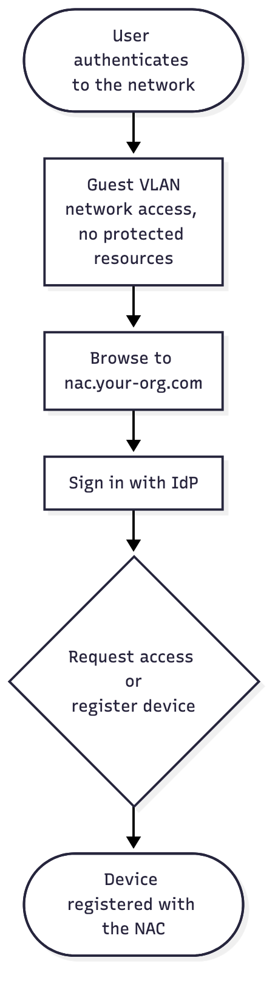

# User Story: MAB Registration Workflow

## Story

As a **user**, I want to register my device with the NAC after I connect, so that the network knows which device is mine.

## Flow

1. The user authenticates to the network normally and is placed in the **guest VLAN**. They have network access and some other services, but not the protected resources that your firewall restricts.
2. The user navigates to `nac.your-org.com`.
3. They sign in with your IdP.
4. They are prompted to **request access** or **register their device** with the NAC.
5. The device is registered with the NAC.

Source: [`mab-registration-workflow.mmd`](mab-registration-workflow.mmd)

## Acceptance criteria

- [ ] A new device lands in the guest VLAN and cannot reach protected resources.
- [ ] `nac.your-org.com` is reachable from the guest VLAN.
- [ ] Sign-in goes through the organization's IdP.
- [ ] The user can request access or register the current device.
- [ ] The registered device is stored with its MAC and owning user.

## Notes

- Registering does **not** by itself grant secured VLAN access. That is the next story: [Secured VLAN Access](secured-vlan-access.md).
