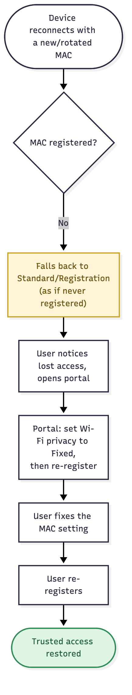

# User Story: MAC Randomization Recovery

## Story

As a **user** whose device rotates its MAC address, when I lose my trusted access because the network no longer recognizes the device, I want to be told why and how to fix it, so I can get back to trusted access myself instead of filing a support ticket.

## Flow

1. A previously-registered device connects with a new, rotated MAC — iOS "Rotating", Android "non-persistent", or a Windows daily-change setting.
2. The MAC lookup finds no match for the new address, so the device falls back to Standard or Registration VLAN, exactly as if it had never registered.
3. The user notices they've lost trusted access and opens the portal.
4. Signed in, but with no registration matching this device's current MAC, the portal tells them why: set the Wi-Fi privacy setting for this network to **Fixed/Off**, then register again.
5. The user changes that setting on the device.
6. The user re-registers. The device is now stable under its fixed MAC.

Source: [`mac-randomization-recovery.mmd`](mac-randomization-recovery.mmd)

## Acceptance criteria

- [ ] A device with a changed MAC is treated as unregistered, not rejected — it falls back to the deployment's normal outcome.
- [ ] The portal shows fixed-MAC instructions to a signed-in user whose device doesn't match any of their registrations.
- [ ] Re-registering under the new, now-fixed MAC restores trusted access.
- [ ] Old, abandoned registrations from earlier rotated MACs don't just pile up silently — they're visible so the user or an admin can clean them up.

## Notes

- This is a direct consequence of the MAC-bound model described in [Outline's MAC randomization section](../OUTLINE) — there's nothing new to build beyond surfacing the right message at the right time.
- Applies the same whether registration is optional ([MAB Registration Workflow](mab-registration-workflow)) or required ([Mandatory Registration](mandatory-registration)).
