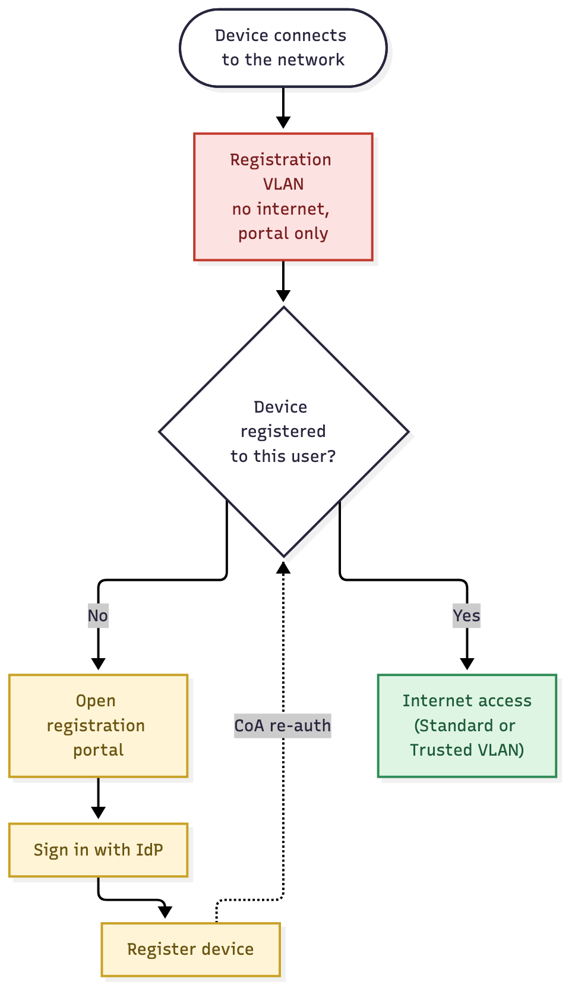

# User Story: Mandatory Registration

## Story

As a **network admin**, I want every device to register before it gets internet access, so that no device reaches the network anonymously — registration isn't optional, it's the only way in.

As a **user**, when I connect with a new device, I expect to be dropped into a registration-only network with no internet until I sign in and register that device.

## Flow

1. A device connects to the network and is placed in the **Registration VLAN**: no internet, only the registration portal (and whatever DNS/DHCP it needs to reach it) is reachable.
2. The device stays there until it's registered to a user. There's no other way out.
3. The user opens the registration portal and signs in with the IdP.
4. The device is registered: its MAC is bound to the user.
5. A CoA re-auth re-evaluates the device. Now registered, it moves off the Registration VLAN and gets internet.

Source: [`mandatory-registration.mmd`](mandatory-registration.mmd)

## Acceptance criteria

- [ ] An unregistered device gets no internet access, on any SSID or wired port covered by this policy.
- [ ] The registration portal (and SSO) stays reachable from the Registration VLAN even though nothing else is.
- [ ] Once registered, the device gets internet without needing a reconnect (CoA handles it).
- [ ] A device that's deregistered, disabled, or expired drops back to the Registration VLAN on its next re-auth.

## Notes

- This differs from the [MAB Registration Workflow](mab-registration-workflow): that flow gives an unregistered device a working guest VLAN and treats registration as an upgrade. Here, registration is the gate — there's no internet-capable VLAN to fall back to.
- The registration portal itself, and whatever it depends on (IdP, DNS), must stay reachable from the Registration VLAN, or no one can ever get out of it.
