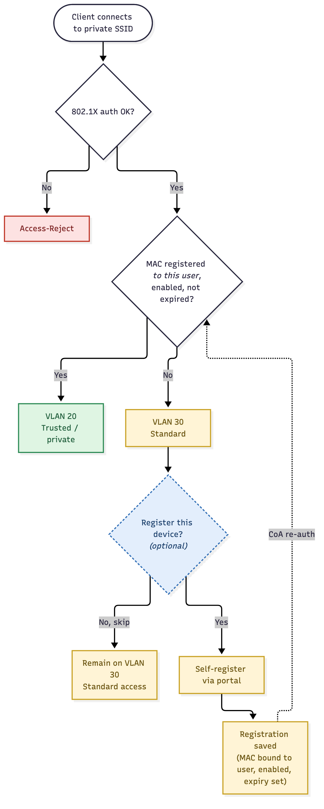

# NAC Workflow

This describes what happens when a client connects to the private SSID, and how optional device registration moves a client from standard to trusted access. The diagram is in [`nac-workflow.mmd`](nac-workflow.mmd) (rendered: [`nac-workflow.png`](nac-workflow.png)).

## Outcomes

| Outcome | Result | Meaning |
|---|---|---|
| Access-Reject | No network access | 802.1X authentication failed |
| VLAN 20 | Trusted / private | MAC is registered to this user, enabled, and not expired |
| VLAN 30 | Standard | Authenticated, but the device is not registered (or registration is unusable) |

## Step by step

1. **Client connects** to the private SSID (WPA2/WPA3-Enterprise).
2. **802.1X authentication.** FreeRADIUS authenticates the user (PEAP-MSCHAPv2 against AD, or EAP-TLS). If this fails, the client gets **Access-Reject** and the flow ends.
3. **MAC lookup in post-auth.** The AP sends the client MAC in `Calling-Station-Id` on every 802.1X request. FreeRADIUS checks whether that MAC is registered **to the authenticated user**, is **enabled**, and is **not expired**.
   - **Yes:** the client is placed on **VLAN 20 (Trusted)**.
   - **No:** the client is placed on **VLAN 30 (Standard)**.
4. **Optional registration.** A client on VLAN 30 can choose whether to register the device.
   - **Skip:** the client stays on VLAN 30 with standard access. Nothing is required of them.
   - **Register:** the client uses the self-registration portal.
5. **Registration is saved.** The MAC is bound to the user, marked enabled, and given an expiry.
6. **CoA re-authentication.** A RADIUS Change-of-Authorization forces the client to re-auth, which re-runs the MAC check (step 3). The device now matches and moves to **VLAN 20**.

## Key rules

- **Registration is optional.** Unregistered users still get working (standard) network access; registering only upgrades them to trusted.
- **MACs are bound to users.** The check is MAC **and** authenticated username, not just "is the MAC on a list". A spoofer would also need the other user's password or certificate.
- **Registrations can lapse.** A disabled or expired registration falls back to VLAN 30, and the user can register again.
- **Single authentication.** MAB and 802.1X are not run as separate steps; the MAC check is done in post-auth of the same 802.1X exchange.

See [`../OUTLINE.md`](../OUTLINE.md) for the schema and implementation details.
