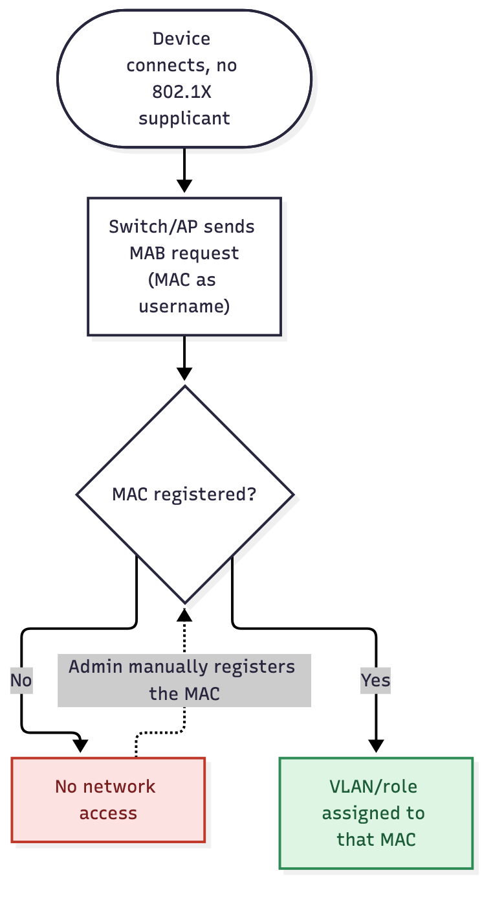

# User Story: Non-802.1X Onboarding — Mandatory

## Story

As an **admin**, I want devices that can't run 802.1X or browse to a portal — printers, cameras, IoT — to get no network access at all until I register them by hand, matching the same "no access without registration" posture as [Mandatory Registration](mandatory-registration) for everything else.

## Flow

1. The device connects to a port or SSID with no 802.1X supplicant.
2. The switch or AP sends a MAB request: the device's MAC as the username, no EAP.
3. FreeRADIUS looks the MAC up directly. There's no authenticated username here, so this isn't the same "MAC + user" check the 802.1X flows use.
4. If the MAC is registered, enabled, and not expired, it returns that device's assigned VLAN/role.
5. If it's unregistered, the device has no way to register itself, and gets **no network access at all**. An admin has to add it by hand from the dashboard before it gets anywhere.

Source: [`non-8021x-onboarding-mandatory.mmd`](non-8021x-onboarding-mandatory.mmd)

## Acceptance criteria

- [ ] An admin can register a MAC-only device from the dashboard, with no username required (or scoped to a service/owner account instead).
- [ ] A MAB request for a registered MAC gets that device's assigned VLAN.
- [ ] A MAB request for an unregistered MAC gets no network access — there's no self-service path, and no default/guest fallback either.
- [ ] This kind of registration is visibly distinct in the dashboard from user-bound registrations.

## Notes

- This is the README's MAB roadmap item — distinct from [MAB Registration Workflow](mab-registration-workflow), which assumes a supplicant that can authenticate a user and browse to the portal.
- Because there's no username to bind to, a pure MAB registration doesn't get the "MAC + authenticated username" anti-spoofing guarantee described in [Outline](../OUTLINE). Treat the registration itself as the trust boundary, and keep whatever VLAN these land on tightly scoped.
- Counterpart: [Non-802.1X Onboarding — Optional](non-8021x-onboarding-optional), where an unregistered device gets a default/guest network instead of nothing.
