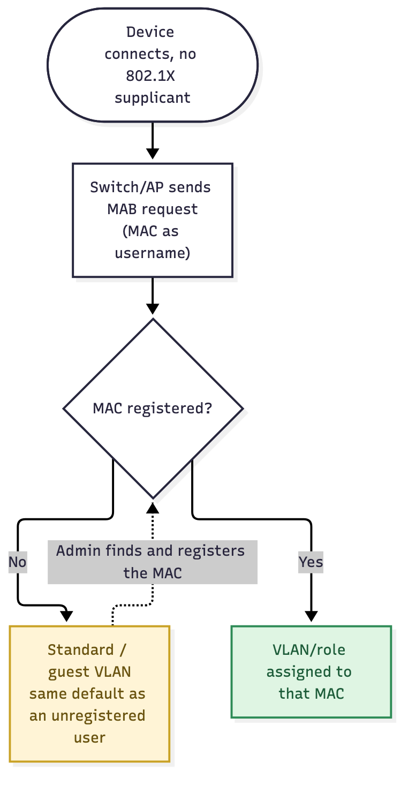

# User Story: Non-802.1X Onboarding — Optional

## Story

As an **admin**, I want an unrecognized device that can't run 802.1X or browse to a portal — a printer, camera, or other IoT — to land on the same default Standard/guest network an unregistered user would get, so it has working access right away instead of nothing. Registering it is how it gets promoted, not how it gets online at all.

## Flow

1. The device connects to a port or SSID with no 802.1X supplicant.
2. The switch or AP sends a MAB request: the device's MAC as the username, no EAP.
3. FreeRADIUS looks the MAC up directly. It isn't found.
4. The device is placed on the **Standard/guest network** — the same default an unregistered 802.1X device gets under [NAC Workflow](nac-workflow) — rather than rejected.
5. An admin later finds the device (by its MAC on the switch, or in DHCP leases) and registers it with a role, since the device itself can never visit a portal.
6. A re-auth or CoA moves it to its assigned VLAN.

Source: [`non-8021x-onboarding-optional.mmd`](non-8021x-onboarding-optional.mmd)

## Acceptance criteria

- [ ] An unregistered MAC gets the same default Standard/guest access an unregistered 802.1X device would get under this policy — not nothing.
- [ ] An admin can find and register an unrecognized MAC without the device itself doing anything.
- [ ] Once registered, the device moves to its assigned VLAN on its next re-auth or CoA.
- [ ] Nothing about this path requires the device to run 802.1X or reach a portal.

## Notes

- Counterpart to [Non-802.1X Onboarding — Mandatory](non-8021x-onboarding-mandatory), where an unregistered device gets no access at all. Which one applies depends on which registration policy is in effect.
- Because there's no username to bind to, a MAB registration doesn't get the "MAC + authenticated username" anti-spoofing guarantee described in [Outline](../OUTLINE). Treat the registration itself as the trust boundary, and keep whatever VLAN these land on tightly scoped.
