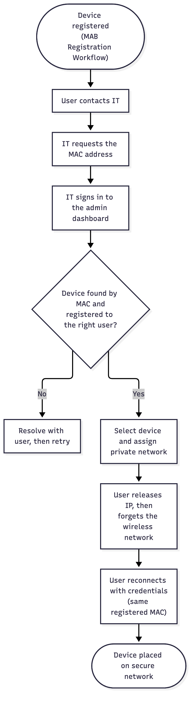

# User Story: Secured VLAN Access

## Story

As a **user with a BYOD device**, I want IT to place my registered device on the secure network, so that I can reach the private network.

As an **IT admin**, I want to approve a device from the admin dashboard and assign it a private network, so that only vetted devices get secure access.

## Prerequisite

The user has already registered the device through the [MAB Registration Workflow](mab-registration-workflow.md).

## Flow

1. The user contacts the IT department and says they want their BYOD placed in the secure network.
2. IT requests the device's MAC address.
3. IT logs into the openNAC admin dashboard.
4. IT finds the device by MAC and confirms it is registered under the appropriate user's profile.
5. IT selects the device and chooses the private network it should have access to.
6. IT tells the user to release their device's IP, then disconnect from the wireless network (forget the network credentials).
7. The user reconnects to the wireless network with their credentials, using the same, already registered MAC address, and lands on the secure network.

Source: [`secured-vlan-access.mmd`](secured-vlan-access.mmd)

## Acceptance criteria

- [ ] The admin dashboard can search devices by MAC.
- [ ] The admin can see which user a device is registered to.
- [ ] The admin can assign a device to a specific private network.
- [ ] After reconnecting with the same MAC, the device is placed on the assigned network.
- [ ] A device that is unregistered or registered to a different user does not get the secure network.

## Notes

- Step 6 matters because the device must renew its IP and re-authenticate to pick up the new VLAN. A CoA from the NAC could remove the manual steps later.
- The device must keep the same MAC. Private or randomized Wi-Fi MAC settings will break the match.
