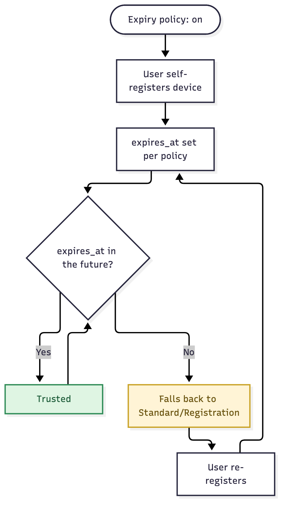

# User Story: Optional Self-Registration Expiry

## Story

As an **admin**, I want to optionally set self-registered devices to expire after a period, so they don't stay trusted forever without anyone re-confirming them. Off by default.

As a **user**, when my self-registered device's registration expires, I want to be dropped back to Standard/Registration access and prompted to re-register, rather than silently staying trusted or being rejected outright.

## Flow

1. The admin turns on an expiry policy (e.g. 180 days) for self-registered devices. Off by default — nothing expires unless this is turned on.
2. A user self-registers a device, through [MAB Registration Workflow](mab-registration-workflow) or [Mandatory Registration](mandatory-registration). `expires_at` is set according to the policy.
3. The device keeps re-authenticating normally while `expires_at` is still in the future.
4. Once `expires_at` passes, the next re-auth's MAC lookup fails the `expires_at > NOW()` check.
5. The device falls back to Standard/Registration VLAN, same as an unregistered device.
6. The user re-registers through the normal flow, which sets a fresh `expires_at`.

Source: [`self-registration-expiry.mmd`](self-registration-expiry.mmd)

## Acceptance criteria

- [ ] Expiry is off by default; turning it on only applies to self-registered devices.
- [ ] Devices placed by IT through [Secured VLAN Access](secured-vlan-access) are not subject to this policy.
- [ ] An expired device falls back to the deployment's normal unregistered outcome — it isn't rejected outright.
- [ ] Re-registering resets the expiry clock.

## Notes

- Builds entirely on the `expires_at` column already in [Outline's schema](../OUTLINE) — this is a policy for whether and how it gets set on self-registration, not a new field.
- Worth considering a warning before expiry (a portal banner, say) so re-registration isn't a surprise — left open, not a hard requirement here.
